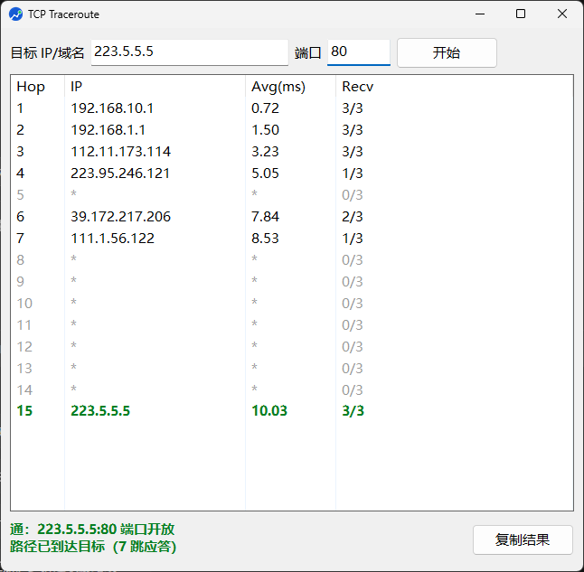

# TCPTrace

基于 [nexttrace](https://github.com/nxtrace/NTrace-core) 的 TCP 路径追踪图形工具。单文件、免安装、双击即用（自动请求管理员权限）。

输入目标 IP/域名和端口，对目标做 **TCP SYN 路径追踪**（经 WinDivert 驱动），并在到达后对目标端口做 TCP 握手测试，给出「通 / 半通 / 不通」结论。

## 软件截图



上图是追踪 `223.5.5.5:80` 的实际运行结果，界面自上而下分三块：

| 区域 | 说明 |
|---|---|
| 顶部工具栏 | 左侧填目标 IP/域名，中间填端口（留空默认 443），右侧「开始」触发追踪 |
| 中部表格 | 逐跳结果：`Hop` 跳数、`IP` 该跳应答地址、`Avg(ms)` 往返时延均值、`Recv` 应答/探测比（`3/3` 为全通） |
| 底部结论条 | 左两行为追踪结论与端口连通性判定（绿=通 / 橙=半通 / 红=不通），右下角「复制结果」导出文本报告 |

表格配色规则与下方「使用」一节对应：灰色 `*` 行为超时无应答，绿色加粗行（图中第 15 跳 `223.5.5.5`，`10.03` ms）为到达目标的最后一跳。

## 使用

| 平台 | Windows 10/11 x64（不支持 Win7：nexttrace 与 WinDivert 2.x 的限制） |
|---|---|
| 分发物 | `dist/TCPTrace.exe`（约 19MB 单文件） |
| 权限 | 双击后弹 UAC，需管理员（加载 WinDivert 驱动必需） |

1. 输入目标 IP/域名，端口留空默认 443，回车或点「开始」
2. 表格实时显示每一跳（可同时显示 20+ 跳）：
   - 灰色行 = 超时无应答
   - 绿色加粗行 = 到达目标的最后一跳
   - 橙色行 = 未到达时的最后应答跳（故障点通常在其后）
3. 结束后自动测试目标端口，底部给出两行结论：
   - **通**：端口开放，TCP 握手成功（绿）
   - **半通**：主机可达，端口未开放 / RST 拒绝（橙）
   - **不通**：无应答（中间防火墙丢包或路由中断）或收到不可达通告（红）
4. 点右下角「复制结果」复制纯文本报告（等宽对齐，可直接贴工单/聊天）：

   ```text
   TCP 路径追踪报告
   目标：223.5.5.5:80
   时间：2026-10-14 20:12:06
   结果：通：223.5.5.5:80 端口开放
        路径已到达目标（7 跳应答）

   Hop  IP                  Avg(ms)  Recv
     1  192.168.10.1           0.72  3/3
     2  192.168.1.1            1.50  3/3
     3  198.51.100.114         3.23  3/3
     4  203.0.113.121          5.05  1/3
     5  *                         *  0/3
     6  198.51.100.206         7.84  2/3
     7  203.0.113.122           8.53  1/3
     8  *                         *  0/3
     9  *                         *  0/3
    10  *                         *  0/3
    11  *                         *  0/3
    12  *                         *  0/3
    13  *                         *  0/3
    14  *                         *  0/3
    15  223.5.5.5             10.03  3/3
   ```

   > 上表对应上方「软件截图」那次追踪（`223.5.5.5:80`）：15 跳中 7 跳有应答，第 15 跳到达目标，端口 80 开放。中间跳 IP 已替换为 RFC 5737 文档保留段（`198.51.100.0/24`、`203.0.113.0/24`），实际数值以你的追踪结果为准。

## 单文件原理

`TCPTrace.exe` 内嵌官方 nexttrace **tiny 版**（v1.7.4，封装层恒传 `-d disable-geoip`，tiny 省掉内嵌 IP 地理库，体积减半）：

- 首次启动把 nexttrace 释放到 `%LOCALAPPDATA%\TCPTrace\`，并执行 `--init` 释放 WinDivert 驱动
- 释放前做 SHA-256 校验，文件缺失/被篡改/主程序升级时自动重新释放
- 之后启动零解压，毫秒级
- 关闭窗口或进程被强杀时，通过 Job Object（`KILL_ON_JOB_CLOSE`）由内核保证 nexttrace 一并退出，无孤儿进程

> 杀软提示：单文件内嵌了另一个 exe（与 PyInstaller onefile 同构），个别杀软可能报「打包器」，加信任排除即可。本工具未加壳、未压缩。

## 构建方法

1. 安装 Go 1.26+（本机 `D:\Go`），把 `nexttrace-tiny_windows_amd64.exe` 放到仓库根目录（从 [NTrace-core Releases](https://github.com/nxtrace/NTrace-core/releases) 下载 Windows amd64 **tiny** 版并重命名；该文件不入库，`.gitignore` 已忽略）
2. 运行 `gotrace\build.bat`，产物输出到 `dist\TCPTrace.exe`
3. 首次构建会自动 `go install github.com/tc-hib/go-winres`（生成图标/清单/版本资源，需要网络）

构建流程：复制 tiny exe 到 `gotrace/assets/`（供 go:embed）→ go-winres 生成 `.syso`（requireAdministrator 清单 + comctl32 v6 + 图标 + 版本信息）→ `go build -trimpath -ldflags "-s -w -H windowsgui -X main.embeddedHash=<sha256>"`。

## 调试

| 变体 | 用途 |
|---|---|
| `gotrace/trace_debug.exe -console 目标 端口` | 控制台跑追踪链路，无 UAC、无 GUI |
| `gotrace/gui_debug.exe` | asInvoker 清单的 GUI，免提权看界面布局 |

## 代码结构

```
gotrace/
├── main.go        入口（GUI / -console 调试模式）
├── asset.go       go:embed、SHA-256 校验、释放、--init
├── trace.go       子进程管理、逐行解析、Job Object 连带释放
├── tablemodel.go  TableView 数据模型与逐行着色
├── render.go      表格渲染与两行式结论生成（console 模式复用）
├── porttest.go    端口连通性测试（OPEN/CLOSED/TIMEOUT/UNREACH）
├── ui.go          walk 界面、结论自绘、复制报告
└── winres/        清单/图标/版本资源配置（winres.json）
```

核心追踪能力来自 [nexttrace](https://github.com/nxtrace/NTrace-core)

## 开源协议

本项目遵循 [GPL-3.0](LICENSE) 协议开源（继承上游 [NTrace-core](https://github.com/nxtrace/NTrace-core) 的 GPL-3.0）：

- `gotrace/` 下的封装层代码以 **GPL-3.0-or-later** 发布
- 内嵌的 nexttrace 官方二进制（tiny 版 v1.7.4）来自 [NTrace-core Releases](https://github.com/nxtrace/NTrace-core/releases)，本项目未修改其源代码，完整源码见原仓库
- 随包释放的 WinDivert 驱动来自 [WinDivert](https://reqrypt.org/windivert.html)（LGPL-3.0 / GPL-3.0 双许可），由 nexttrace 官方构建分发
